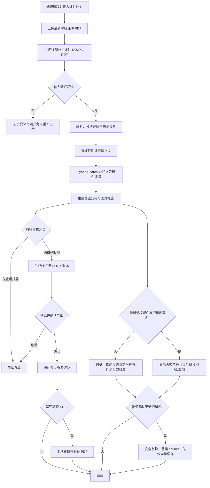

# 新旧课件比对与补习课件更新：执行方案

> 状态：实施中；MVP 第一阶段代码已开始落地，当前能力与限制见第 16 节。  
> 目标：在现有 AI 教学助手中加入可审核、可追溯的新旧课件比对与补习课件更新工作流，并以 LangGraph 展示一个边界清晰的 agentic demo。  
> 原则：原文件不被静默覆盖；模型建议必须有课件证据；修改和知识库更新均需教师确认。

## 1. 项目背景与当前基线

本项目是 Streamlit 本地教师工作台，当前主要能力为课程 PDF 解析、文本分块、本地索引、Hybrid Search（embedding + BM25 + RRF）和 LLM 辅助生成。

实现前应以代码为准重新核对下列基线：

- 资料库 UI 当前只接受 PDF。
- `DocumentLoader` 当前解析 PDF，并将解析结果分块后保存到课程索引。
- `sync_directory` 是新增文件的增量合并，不负责按内容替换现有文档、删除旧 chunks 或回滚失败的替换。
- embedding 缓存与课程索引分开保存；替换文档时必须考虑缓存失效。
- 已配置的 LLM provider 是 DeepSeek API。虽然原始文件和索引保存在本机，发送给 LLM 的文本仍会离开本机。
- 现有备课生成会把所选资料整体按顺序提供给模型；新功能是单独的工作流，不应改变现有备课、讲题行为。

相关现有代码：

- `app.py`：页面导航、上传入口和知识库加载。
- `src/document/document_loader.py`：资料解析、索引存取和 `sync_directory`。
- `src/document/pdf_parser.py`：PDF 解析和 document ID 生成。
- `src/document/text_chunker.py`：chunking。
- `src/retrieval/retriever.py`：Hybrid Search。
- `src/core/config.py`：格式、chunking、embedding 和 LLM 配置。
- `src/rag/`：现有生成链路、LLM 调用和引用校验。

## 2. 目标与非目标

### 2.1 首版目标（MVP）

1. 在 Streamlit 中增加独立的「新旧课件比对与更新」区域。
2. 支持上传：
   - 最新学校课件：PDF。
   - 往期补习课件：DOCX；首版可同时允许 PDF 作为只读输入。
3. 抽取最新学校课件中的知识点，并逐项检索补习课件中的支持证据。
4. 给出有来源位置的覆盖矩阵、差异和优化建议；保留“部分覆盖”“证据不足”“可能冲突”等状态，不能只给二元结论。
5. 教师审核并选择建议后，生成一份新的修订版 DOCX 和修改摘要；不直接改写上传的原文件。
6. 将 DOCX 转为 PDF 作为可选导出；转换不可用或失败时明确报错，不假装成功。
7. 若最新学校课件与课程资料库已有文件重名，显示冲突和处理选择；只有教师确认后才能替换。
8. 课程资料库替换成功后，旧文档及其 chunks 被一致移除，新文档重新解析和分块，相关向量缓存失效。
9. 用 LangGraph 编排带状态的流程，并将“采用修改建议”和“更新课程资料库”设为独立的人审关卡。

### 2.2 首版不做

- 不无人审核地改写并覆盖补习课件或课程资料库。
- 不承诺模型可以证明“完全覆盖”；报告必须允许证据不足和人工判定。
- 不做自动知识图谱构建、GraphRAG 或复杂的多 Agent 协作。
- 不尝试无损编辑 DOCX 中所有复杂版式、SmartArt、文本框、OLE 对象或嵌入对象。
- 不改变现有备课、期末复习、作业讲题流程。
- 不引入长期对话记忆；首版仅持久化当前任务所需状态和生成文件。

## 3. 用户流程



资料比对和资料库更新是分开的：上传的文件先放在任务暂存区，不能因为上传或比对就自动进入课程知识库。

## 4. 技术设计

### 4.1 编排选择：LangGraph

推荐首版使用 LangGraph 的 StateGraph 编排确定性节点和人工确认边界，而不是建立自由漫游的 agent。LLM 负责知识点抽取、证据判定和建议撰写；文件读写、检索、导出、索引替换由受控 Python 节点执行。

优势：

- 状态与步骤显式，适合暂停等待教师审核后继续。
- 关键操作有固定入口，避免模型自行决定覆盖路径或任意执行文件操作。
- 节点可单独测试；失败时可以定位到解析、检索、生成、转换或索引更新阶段。
- 可作为项目技术栈演示，但不会让框架本身取代已有 RAG、DocumentLoader 或 Hybrid Search。

首版只需要同步执行和 Streamlit session 中的任务状态即可。若后续需要服务重启后恢复待审核任务，再评估 LangGraph checkpointer 和持久化存储。不要在 MVP 中把完整课件正文写入长期 checkpoint；持久化任务 ID、文件引用、hash、审核选择和节点状态即可。

### 4.2 建议的图节点

| 节点 | 职责 | 失败行为 |
|---|---|---|
| `validate_uploads` | 校验扩展名、大小、空文件、课程范围、文件名和任务 ID | 终止该任务并显示明确错误 |
| `stage_files` | 写入任务专属暂存目录，计算 SHA-256，记录原文件名 | 不修改资料库 |
| `parse_documents` | PDF/DOCX 提取文本与页码/段落来源位置 | 报告无法解析的文件或页面，不静默忽略 |
| `extract_latest_topics` | 从最新学校课件生成结构化知识点清单及来源 | 校验输出 schema；失败可有限重试，之后展示错误 |
| `retrieve_tutoring_evidence` | 对每个知识点调用 Hybrid Search，限制在本次补习课件 chunks | 返回明确的无证据结果，不编造 |
| `assess_coverage` | 根据学校课件原文和补习课件检索证据评估覆盖度 | 保留证据引用和不确定性 |
| `build_gap_report` | 生成统一的覆盖矩阵、摘要和修改建议 | 缺失项报告错误，不输出成功形态的空报告 |
| `review_report` | 等待教师查看、编辑/勾选建议 | 取消后结束任务，不修改文件 |
| `create_revision_plan` | 将已选建议整理为可执行、可审阅的文档修改计划 | 要求每条修改关联知识点和证据 |
| `write_docx_revision` | 根据审核计划创建新 DOCX 副本 | 原件保持不变；写入失败时保留错误 |
| `review_revision` | 展示修改摘要，教师确认保存及可选 PDF 导出 | 未确认则不导出或覆盖任何文件 |
| `export_pdf` | 调用本机转换器，将修订版 DOCX 转为 PDF 并验证结果 | 明确告知缺少转换器或转换失败 |
| `check_library_conflict` | 按所选课程比较文件名和内容 hash | 返回冲突清单，不执行覆盖 |
| `review_library_update` | 询问保留、替换、加入新版本或取消 | 未确认即不修改资料库 |
| `replace_library_document` | 事务式更新原文件、索引、chunks 和向量缓存 | 任一步失败则回滚或恢复备份 |
| `finish` | 汇总产物路径、资料库变更和任务状态 | 仅报告已验证完成的操作 |

可将 `check_library_conflict` 并行于比对报告生成，但只有在其结果确定后才显示相应的用户选择。

### 4.3 State 状态结构

定义有类型的任务状态（建议 TypedDict 或等价类型），字段至少包括：

```text
task_id
course_id
stage_dir
latest_school_file: 文件引用、原始文件名、扩展名、sha256
previous_tutoring_file: 文件引用、原始文件名、扩展名、sha256
parsed_school_pages / parsed_tutoring_sections
school_topics[]
topic_evidence[]
coverage_report
selected_recommendation_ids[]
revision_plan[]
revision_docx_path
revision_pdf_path
same_name_conflicts[]
library_update_decision
task_status
error
```

要求：

- State 中不放 API key；不将课件正文写入应用日志。
- 图状态保存可序列化的结构化数据和文件引用；节点从受控暂存路径读取内容。
- 各节点校验输入 schema，错误状态与完成状态不能混淆。
- 为每个任务生成随机 task ID；拒绝路径穿越和未经授权的任意路径。
- 暂存目录应有过期清理策略，只有已结束或已过期任务可以清理。

### 4.4 覆盖矩阵 schema

建议每个知识点记录：

```json
{
  "topic_id": "稳定的任务内 ID",
  "topic": "知识点名称",
  "description": "学校课件对该知识点的要求或解释",
  "school_sources": [
    {"file": "最新课件.pdf", "page": 4, "quote": "原文短摘录"}
  ],
  "coverage": "covered | partial | missing | conflict | uncertain",
  "tutoring_sources": [
    {"file": "往期补习.docx", "section": "第三章", "paragraph": 8, "quote": "原文短摘录"}
  ],
  "gap": "差异或未覆盖内容",
  "recommendation": "教师可审核的建议",
  "confidence": 0.0
}
```

置信度仅用于排序和提示，不应被解释成严格概率。LLM 输出需经 Pydantic 或项目内 schema 校验；每个非 `missing` 的状态都必须附至少一条补习课件证据，若无证据则不能判为已覆盖。对引用保存短摘录和定位信息，不要只保存模型生成的 paraphrase。

### 4.5 文档解析与定位

- 最新学校课件首版继续使用 PDF 解析器，保存页码和原文片段。
- 新增 DOCX 读取时，为每个段落、标题、表格单元格生成稳定的 section/paragraph 定位 ID；不要伪造 PDF 页码。
- PDF 补习课件保留页码。
- 统一内部来源结构，例如 `document_id + page_number? + section_path + paragraph_index + chunk_id`。
- 表格内容必须以可读文本形式提取，且保留表格/行列位置；无法可靠提取的图表或图片应提示教师检查。
- DOCX 公式、图片、文本框或复杂排版可能导致解析不完整；在报告中标记解析局限。

## 5. DOCX 修订与 PDF 导出

### 5.1 安全修改策略

首版不得直接覆盖原 DOCX。推荐输出到独立目录，例如：

```text
data/<course>/course_updates/<task_id>/
  comparison_report.json
  comparison_report.md
  revision_plan.json
  <原文件名>_updated_<日期>.docx
  <原文件名>_updated_<日期>.pdf   # 可选
  manifest.json
```

`manifest.json` 记录输入文件名和 SHA-256、生成时间、所用模型/工作流版本、审核过的建议 ID、输出文件 hash 和转换状态，不记录密钥。

DOCX 更新策略由简单到复杂：

1. MVP 只对常规段落和简单表格进行受控插入/替换；保留原文件副本和原段落次序。
2. 生成前展示修改计划：目标章节、依据的学校课件知识点、补习课件现有证据、拟新增/修改内容。
3. 对无法安全定位或处理的复杂对象，不自动改动；将建议放入“待手动补充”附录或报告。
4. 输出后重新打开 DOCX 并校验可读取、非空、目标修改已写入；否则标记失败。
5. 输出修订摘要，列出每个变更的理由、对应知识点、来源位置和状态。

### 5.2 DOCX 转 PDF

- PDF 转换是可选功能，使用本机安装的转换器（例如 LibreOffice headless）；不得依赖未声明的隐式系统工具。
- 应在启动检查中检测转换能力，UI 显示“可用/不可用”及说明。
- 先生成到临时输出文件；检查文件存在、大小大于零且能被 PDF parser 重新打开后再移动到最终路径。
- 转换失败时保留 DOCX 和错误信息，不声称 PDF 已生成。
- Docker 部署若要支持转换，必须显式安装并测试转换器；本地安装版本不可用时应降级为仅 DOCX 导出，而非中断整条流程。

## 6. 资料库同名检测、替换和索引一致性

### 6.1 冲突策略

冲突检测必须限制在当前选定课程的资料库，并同时比较：

- 文件名（大小写与 Unicode 规范化后比较）。
- 内容 SHA-256（识别完全相同文件，避免重复入库）。
- 文件类型和文档 ID。

同名不等于同内容，也不等于一定应该覆盖。对教师提供清楚选择：

1. **保留原文件，不加入资料库**。
2. **作为新版本另存**（推荐默认选项，若项目有版本管理能力）。
3. **替换旧版本**（展示旧/新 hash、文件大小和解析统计后再确认）。
4. **取消**。

如系统当前没有可靠的版本记录，首版默认“保留原文件/不更新”；不能将“同名”自动解释为覆盖授权。比较任务本身可以继续，不应因资料库冲突被迫覆盖。

### 6.2 原子替换流程

替换必须作为可回滚操作处理：

1. 校验教师确认、课程 ID、文件名、暂存文件 hash 和目标文档 ID。
2. 在目标目录内保留旧原件备份及索引快照，记录事务 ID。
3. 将新文件写入同目录临时文件，flush 后校验 hash，再原子 rename。
4. 解析新文件并生成全新 document/chunks；新 document ID 应来源于内容 hash，保证版本变化可区分。
5. 构建候选索引：移除旧 document ID 及其所有 chunks，再加入新 document 和 chunks。
6. 验证候选索引统计、引用位置和序列化，再原子写入索引文件。
7. 删除或版本化失效 embedding cache；确保下次查询不会使用旧向量。缓存最好包含索引内容 hash/版本作为校验标记。
8. 清理 Retriever/知识库资源缓存并重新加载，验证新文档可检索、旧版本不再误召回。
9. 只有所有步骤成功后才标记事务完成并保留备份至策略规定的期限。
10. 任一步骤失败，恢复旧原件和索引，保留错误/事务记录并通知教师。

索引文件与原始文件不在同一文件系统事务中，因此应通过显式备份和恢复实现一致性，不能只依赖临时变量或 Streamlit 缓存清除。

### 6.3 与现有 `sync_directory` 的关系

不要把覆盖逻辑塞进现有“只增量添加”的 `sync_directory`，以免改变常规资料库刷新语义。建议新增独立、可测试的受控 API，例如：

```text
replace_document(course_id, old_document_id, staged_file, expected_sha256)
```

它负责版本校验、移除旧 chunks、重新解析分块、落盘和回滚。必要时抽取索引候选构建/持久化公共 helper，但所有普通新增和替换行为必须有明确语义。

## 7. 隐私、权限和文件安全

- 文档解析和暂存默认在本地进行。
- 调用 DeepSeek 时，相关学校课件/补习课件文本会作为提示上下文发送至配置的 API。启动比对前必须在 UI 明示，并要求教师确认；不得声称全流程数据不离开本机。
- API key 只从既有环境配置读取；禁止写入任务状态、日志、manifest 或生成报告。
- 日志只记录 task ID、阶段、耗时、输入 hash、文档数量和错误类型；默认不记录全文和原始提示。
- 对上传文件设置最大大小、扩展名和实际文件签名检查；DOCX 应检查 ZIP 容器结构，避免只凭扩展名信任。
- 文件名仅作为展示元数据；实际落盘文件名使用内部 task ID/安全生成名，防止路径穿越、覆盖其他文件或同名竞态。
- 限制转换器调用参数，使用固定可执行文件和受控路径，不拼接用户输入到 shell 命令。
- 任务完成后按期限清理暂存文件；教师明确选择保存的报告和修订文件按产品保留规则处理。
- 对扫描 PDF、解析空文本、超长文本、损坏 DOCX 和图片/表格解析局限显式告警。

## 8. 依赖与模块建议

### 8.1 初步依赖

- `langgraph`：状态图编排。
- `python-docx`：读取和生成基本 DOCX。
- `pydantic`：结构化知识点、覆盖矩阵和修改计划校验；如现有依赖已含兼容版本则复用。
- PDF 转换器：优先作为可选系统依赖（例如 LibreOffice），不将平台不可用的转换能力作为应用必需条件。

在实施前确认 LangGraph 与 Python 3.12、当前 LangChain/Core 依赖以及项目 LLM client 的兼容性。尽量不为使用 LangGraph 而迁移现有 DeepSeek 调用；先用项目已有 LLM 封装提供模型调用适配器。依赖必须固定/约束版本并在 AIvenv312 与 Docker 环境分别验证。

### 8.2 目录建议

```text
src/
  course_update/
    __init__.py
    models.py              # typed state、知识点、证据、报告、revision plan
    graph.py               # LangGraph state graph 定义
    nodes.py               # 有边界的工作流节点
    document_parser.py     # PDF/DOCX 对比任务解析适配
    comparison.py          # coverage evidence matching / validation
    docx_revision.py       # 安全生成修订版 DOCX
    pdf_export.py          # 可选转换器适配与结果校验
    library_update.py      # 冲突检测、受控替换、回滚
    storage.py             # task staging、manifest 和清理
tests/
  test_course_update_models.py
  test_course_update_graph.py
  test_docx_revision.py
  test_library_update.py
```

UI 可在 `app.py` 中先增加独立页面；当页面逻辑增长时，按项目结构将页面拆至 `src/ui/`，避免把 LangGraph 节点逻辑写进 Streamlit 脚本。

## 9. 分阶段实施计划

每阶段必须有可运行产物和验收门槛，后续阶段依赖前序阶段结果。

### 阶段 0：基线与设计确认

- 记录现有索引格式、文档 ID 算法、cache 路径、上传目录、Docker OS 和 LLM 数据流。
- 确认业务限制：允许的输入大小、修订输出目录和保留期限。
- 固化 coverage schema、报告示例和老师审核交互。

**完成标准：**替换旧文档的可回滚方案评审通过；隐私提示文案确定；不与现有备课/讲题页面耦合。

### 阶段 1：独立比对核心（不改 DOCX，不写入资料库）

- 新建比较任务暂存和 typed models。
- PDF/DOCX 文本解析及来源定位。
- 结构化抽取学校课件知识点。
- 针对每个知识点调用 Hybrid Search 查询补习课件 chunks。
- 生成覆盖矩阵和 Markdown/JSON 报告；无证据项清楚标记。
- 加入一个独立 Streamlit 页面，显示上传状态、运行结果、来源展开和下载。

**完成标准：**能在真实样例上逐知识点看到学校课件来源和补习课件证据；无证据时不生成“已覆盖”；解析失败有明确提示；不触碰知识库原件和索引。

### 阶段 2：LangGraph 与人审流程

- 将阶段 1 服务封装为 StateGraph 节点。
- 添加教师审核状态：选择要采用的建议、编辑建议内容、取消任务。
- UI 提供明确的任务状态与节点错误；重复执行不产生重复文件或重复索引写入。
- 初期任务状态留在当前进程/Streamlit session；只有确认确有重启恢复需求后再引入 checkpointer。

**完成标准：**图可离线用 fake LLM 测试；教师取消后没有任何文件/索引变更；失败节点能够重试或安全终止。

### 阶段 3：生成修订版 DOCX

- 根据审核后的 revision plan 生成独立 DOCX 副本。
- 输出修改摘要、来源证据和人工待办项。
- 重新读取生成文件进行结构校验。
- 提供教师确认、下载和可选保存本地。

**完成标准：**原 DOCX 的 SHA-256 不变；输出可打开；每个自动生成的修改都能关联到已批准建议；复杂结构不会被静默破坏。

### 阶段 4：可选 DOCX → PDF

- 检测本地转换器；UI 显示状态。
- 实现安全参数调用、临时输出、PDF 重新读取验证和错误报告。
- Docker 与 macOS 分别验证；转换器不可用时仍可完成 DOCX 工作流。

**完成标准：**无转换器、转换失败、输出空文件三种情况均正确报告，不删除 DOCX，也不伪造 PDF 成功状态。

### 阶段 5：课程资料库冲突处理与安全替换

- 按课程扫描同名候选并比较 hash。
- 显示差异，支持保留、取消、另存版本和确认替换。
- 实现 `replace_document` 候选索引、备份、缓存失效、原子落盘和回滚。
- 确保 retriever 资源缓存被正确刷新。

**完成标准：**同名但内容不同默认不覆盖；确认替换后旧 chunks 不再存在、新 chunks 可以检索；注入失败时原文件和旧索引可恢复；相同文件 hash 不产生重复索引。

### 阶段 6：评测、隐私与发布

- 建立代表性比对样例集，覆盖术语变化、跨语言表述、缺项、部分覆盖、过期内容、表格、扫描 PDF 和解析失败。
- 由教师标注 gold coverage 和 evidence；分别评测知识点召回、证据命中和状态判断。
- 比较 prompt/模型改动前后的差异；记录耗时、token 和错误率，不记录全文。
- 更新 README、目录说明、架构图、隐私说明和操作指南。

**完成标准：**离线测试通过；人工样例评测达成团队设定门槛；API 数据流明确披露；回滚演练通过；新增依赖在受支持环境中可安装运行。

## 10. 测试计划

### 单元测试

- PDF/DOCX 上传验证、同名归一化、hash 计算和安全文件名。
- DOCX 段落、标题、表格定位和无法解析结构提示。
- chunk 来源映射和 document_id 版本区分。
- Coverage schema 校验：无证据不可判为 covered；证据 ID 必须来自当前输入。
- 节点成功/失败状态传播、有限重试和取消路径。
- DOCX 副本输出、原件未修改、结构校验和重复运行行为。
- PDF 转换器缺失、超时、失败、空输出、有效输出。
- 索引替换成功、缓存失效、旧 chunks 移除和事务中途失败回滚。

### 集成测试

- LangGraph 全链路使用 fake LLM 和小型 PDF/DOCX fixtures，默认离线。
- Streamlit 交互：上传、报告显示、选择建议、取消、导出和冲突确认。
- 资料库替换后重新加载 Retriever，确认检索结果使用新版本。
- 不触发真实 API 的常规 CI；真实模型评测单独通过人工触发命令运行。

### 质量评测指标

- 知识点召回率：学校课件中的关键知识点是否进入待比对清单。
- Evidence hit rate：报告中的补习课件证据是否真实支持对应判断。
- 误报/漏报：尤其是“已覆盖”误判。
- 引用定位准确率：页码、章节、段落是否可回到原文。
- 解析失败率、任务完成时间、token/API 成本。
- 版本更新一致性：索引、原件、chunks、向量 cache 的版本是否一致。

验收优先级应是减少“无证据但判覆盖”的风险，其次才是追求更高自动化率。

## 11. UI/交互约定

- 新增独立导航项，例如「🆕 新旧课件比对」，不复用普通资料库上传控件。
- 分别标注“最新学校课件”和“往期补习课件”，说明支持格式和限制。
- 点击开始前展示：课程、文件名、大小、格式、LLM 隐私提醒和数据发送说明。
- 处理中显示当前图节点，不只显示一个无限 spinner。
- 报告按知识点展示状态、学校来源、补习证据、差距、建议和置信度；来源原文可展开。
- 对 `missing`、`partial`、`conflict`、`uncertain` 使用不同标签；不得只用颜色表达状态。
- “生成修订版”和“更新课程资料库”是不同按钮/确认步骤，默认均不执行。
- 覆盖确认文案明确说明会影响课程检索，并展示旧/新版本和回滚机制。
- 所有错误显示可采取的操作；失败状态不得显示“完成”或生成空成功报告。

## 12. 风险与缓解

| 风险 | 缓解 |
|---|---|
| LLM 把语义相近误当成完整覆盖 | 要求逐项证据、短摘录、状态校验；低置信度进入人工确认 |
| 新课件改写术语导致检索漏召回 | Hybrid Search + 结构化 query；评测同义词/跨语言样例，允许人工补充检索词 |
| DOCX 复杂格式被破坏 | 原件只读；首版限制支持结构；输出副本并提供预览/人工检查 |
| 同名文件误覆盖 | 文件名仅提示冲突；比较 hash；默认不覆盖；需要明确二次确认 |
| 索引与原件版本不一致 | 候选索引、备份、cache 失效、事务记录和故障回滚 |
| API 隐私认知不一致 | 上传/运行前明示文本可能发送至 DeepSeek，并要求确认 |
| LangGraph 引入过度复杂度 | 固定节点、无自由工具调用、不做多 Agent；独立核心服务可不依赖 UI |
| PDF 转换环境不一致 | 转换能力探测为可选；输出验证；无转换器时保留 DOCX 正常工作 |

## 13. 需要产品/教师确认的默认决策

除非实施前另行确认，采用以下默认值：

1. 旧补习课件原文件永不覆盖；只生成新版本。
2. 最新学校课件先参与比较，不自动加入课程知识库。
3. 同名资料默认保留现有版本；“替换”需明确确认。
4. 第一版学校课件输入只支持 PDF；补习课件支持 DOCX 和可选 PDF。
5. PDF 转换是可选能力；没有可用本地转换器时提供 DOCX 下载并解释原因。
6. 比对及内容生成会调用现有 DeepSeek API；未配置 API key 或未确认隐私提醒时不启动 LLM 节点。
7. 暂存文件按短期任务保留，具体时限在实现阶段结合教师工作习惯确定；明确保存的最终产物不随暂存自动清理。
8. 首版按单次任务运行，不承诺 Streamlit/进程重启后的任务恢复。

## 14. 交付清单

- LangGraph 编排及有类型的任务状态。
- PDF/DOCX 解析适配及来源定位。
- 独立的课件比对 UI。
- 可下载的覆盖矩阵 JSON/Markdown 报告。
- 教师审核后的修订版 DOCX 和修改摘要。
- 可选 PDF 导出及转换能力检测。
- 经过确认、可回滚的资料库文档替换 API。
- 单元/集成/索引回滚测试和真实样例评测集。
- 更新后的架构、目录、隐私、安装和使用说明。

## 15. 实施顺序总结

推荐先完成 **阶段 0 → 阶段 1 → 阶段 2 → 阶段 3**，以“可审核的覆盖报告和修订 DOCX 副本”作为首个可演示版本。确认报告质量、DOCX 输出质量和教师审核流程后，再做 PDF 转换；最后单独实现资料库替换和事务回滚。

这样的顺序既能展示 LangGraph 的状态流转和 human-in-the-loop，也把最容易造成不可逆数据损失的索引替换放到最后，且不会让新功能影响现有 RAG 教学任务。

## 16. 当前实现状态（2026-10）

### 已落地的首版能力

- 增加 Streamlit「新旧课件比对」独立页面。
- 上传最新学校 PDF 与往期补习 DOCX/PDF，按任务 ID 写入本地暂存目录。
- 使用 LangGraph 串联上传校验、解析分块、知识点抽取、Hybrid Search、覆盖判断和报告保存。
- 学校 PDF 引用保留页码；DOCX 证据保留章节标题和 chunk ID，PDF 补习课件保留页码。
- 覆盖报告提供 covered/partial/missing/conflict/uncertain 状态、证据摘录、建议和可下载 JSON/Markdown。
- 后端验证模型返回的 chunk ID；模型无有效证据时不能把条目标为 covered。
- 在教师选择建议后，生成独立的 DOCX 修订副本；不改写源文件。
- 同名课程资料会提示教师；比较流程不自动更新资料库，教师可在报告完成后通过单独确认操作替换。
- 单文件最大 50 MB，每份输入最多 120 个文本片段；超过上限明确失败，避免静默遗漏。
- UI 在调用模型前展示第三方 API 隐私提醒，并要求教师确认。

### 第二阶段新增能力

- 修订版 DOCX 可在本机检测到 LibreOffice 时按需导出 PDF；转换器不可用、超时、失败或输出校验失败均明确报错，DOCX 保留。
- 比对报告下方提供独立的同名资料替换操作，显示新旧 SHA-256，并要求教师明确勾选确认；同内容文件不会重复索引。
- 替换时先在内存构建候选索引，再以原子文件替换提交 PDF 与 JSON 索引；成功后删除课程 embedding 缓存并刷新 Streamlit 知识库资源。
- 替换前旧 PDF 保存在 `data/course_update_backups/<course>/<backup_id>/`；资料库页可选取并重新解析恢复旧版本，恢复操作也会保存当前版本以便再次回滚。
- 替换失败会尽力恢复 PDF、索引和向量缓存；如自动回滚失败，错误提示会保留备份路径供人工处理。

### 尚未实现

- Word 的复杂版式、文本框、公式和嵌入对象的无损修改；首版是在原 DOCX 副本末尾添加审核通过的补充章节。
- LangGraph 跨进程 checkpoint 与重启恢复。
- 任务暂存文件的自动过期清理；目前需按隐私政策手动清理 `data/course_updates/` 中不再需要的任务文件。
- 版本备份自动过期清理；备份保存在本地 `data/course_update_backups/`，需按组织保留策略人工管理。
- 资料库替换的多进程写锁；当前界面按单个 Streamlit 进程顺序执行更新。

### 运行和验证

- 新增依赖：`langgraph==0.2.76`、`python-docx==1.1.2`。
- 离线测试使用 fake LLM 与 fake retriever，不调用外部 API。
- 首次运行新功能前需安装更新后的 `requirements.txt` 并配置 `DEEPSEEK_API_KEY`。
- PDF 导出不增加 Python 依赖；需本机安装 LibreOffice，应用会通过 `soffice` 或 `libreoffice` 命令探测。
