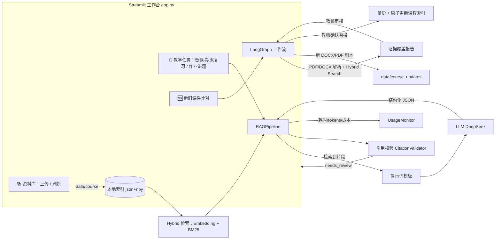

# 系统架构

> 面向教师的“课程资料 → 教学讲义”工作台。检索、解析和工作流在本地运行；
> 配置的 LLM 请求会将相关文本发送到 DeepSeek API。

## 1. 总览

### 两条主链路

- **入库**：`上传 PDF → data/<course>/uploads → DocumentLoader 解析/分块 → 保存索引
  data/index/<course>.json + 向量缓存 .npy`。重启后加载器会把磁盘上新增课件自动合并进索引。
- **生成**：`选择资料范围 + 任务 → 按阅读顺序取所选资料全部片段 → 拼接上下文 →
  提示词 → LLM 真实生成 → 解析 JSON → 校验引用 → 内联展示/导出`。
- **课件比对与更新**：`上传最新学校 PDF + 往期补习 DOCX/PDF → LangGraph 比对和覆盖报告
  → 教师审核 → 新 DOCX 副本 → 可选 LibreOffice PDF 导出`。资料库替换是另一个明确确认操作：
  系统先解析候选文档并构建新索引，再原子替换 PDF/JSON 索引，删除旧 embedding 缓存并刷新 Retriever；
  旧 PDF 保留在 `data/course_update_backups/`，可从资料库页重新解析恢复。

## 2. 分层与模块

| 目录 | 职责 |
|------|------|
| `app.py` | Streamlit UI：侧边栏（课程/模型状态）、资料库页、教学任务页、结果编辑与导出 |
| `src/core/` | `config.py` 配置；`models.py` 数据模型（Document/Chunk/Citation/GeneratedLesson 等） |
| `src/document/` | PDF 解析、语义分块、索引加载/保存/`sync_directory` 增量合并 |
| `src/retrieval/` | Hybrid 检索器：`multilingual-e5-small` 语义召回 + 本地 BM25 关键词召回，使用 RRF 融合排序；向量缓存到磁盘 |
| `src/prompts/` | 备课 / 讲题的提示词模板与消息构建 |
| `src/rag/` | `llm_client`（真实 DeepSeek，无 key 即报错）、`citation_validator`、`pipeline` 生成编排与导出 |
| `src/course_update/` | LangGraph 课件比对、证据校验、DOCX/PDF 导出及有备份回滚的资料库替换 |
| `src/eval/monitor.py` | 每次生成的耗时 / tokens / 成本记录（UI 展示，可选写 `logs/usage.jsonl`） |

## 3. 生成要点（当前实现）

- **备课 / 期末复习（lesson）**：不依赖“本周主题”，而是把所选资料的 chunks **按阅读顺序整体**
  喂给模型（单节课件可整份装入，预算 `cover_max_chars=45000`；超长保留头 60% + 尾 40%），
  覆盖全部知识点；按“课堂时长”自动调整内容规模（≤1h 精简 → >2.5h 超详）；约 3 道多样练习题；
  可在界面勾选“自定义输出要求”，其内容会附加到提示词（不改变 JSON 结构）。
- **作业 / 真题讲题（problem_solving）**：检索限定在所选资料内，输出分步思路 + 分层提示 +
  评分对应，不代写答案（ADR-003）。
- **引用校验**：所有 citation 必须指向真实文档与页码；无效引用被丢弃并写入 `needs_review`
  提示老师确认（ADR-002）。
- **真实生成**：mock 已彻底移除（2026-09）。未配置 `DEEPSEEK_API_KEY` 时直接报错，不会降级。
  LLM 输出 `max_tokens=8192`；`parse_json_response` 按括号配对提取 JSON，抗截断/尾随文本。

## 4. 存储与隐私

- `data/<course>/`：课件（`lectures/`、`uploads/`…）。UI 上传存入 `uploads/`。
- `data/index/<course>.json` + `<course>_embeddings.npy`：索引与向量缓存（派生数据，随课件删除）。
- `logs/usage.jsonl`：可选的使用记录（不含密钥）。
- `data/course_updates/<task_id>/`：比对任务的暂存课件、覆盖报告和修订 DOCX；需按隐私要求管理。
- `data/course_update_backups/<course>/<backup_id>/`：资料库替换前的旧 PDF 版本；需按组织保留策略管理。
- `data/` 与日志已加入 `.gitignore`，**不进版本库、不进 Docker 镜像**；镜像通过卷挂载 `./data`。
- 新旧课件比对会将相关文本发送到配置的 DeepSeek API；开始任务前 UI 要求教师确认。

## 5. 运行与分发

- 本机：`source AIvenv312/bin/activate && streamlit run app.py`
- 新机器：`./scripts/setup.sh && ./scripts/run.sh`，或 `docker compose up -d --build`（详见 README）。
- 测试：`python -m pytest tests/ -q`（离线，使用确定性假 LLM）。

## 6. 关键决策

| 决策 | 文件 |
|------|------|
| 本地检索优先，资料不出本机 | `docs/decisions/ADR-001-local-retrieval-first.md` |
| 结构化输出 + 引用校验 | `docs/decisions/ADR-002-*.md` |
| 讲题不代写（辅导模式） | `docs/decisions/ADR-003-*.md` |
| Streamlit 扁平化工作台 | `docs/decisions/ADR-004-*.md` |
