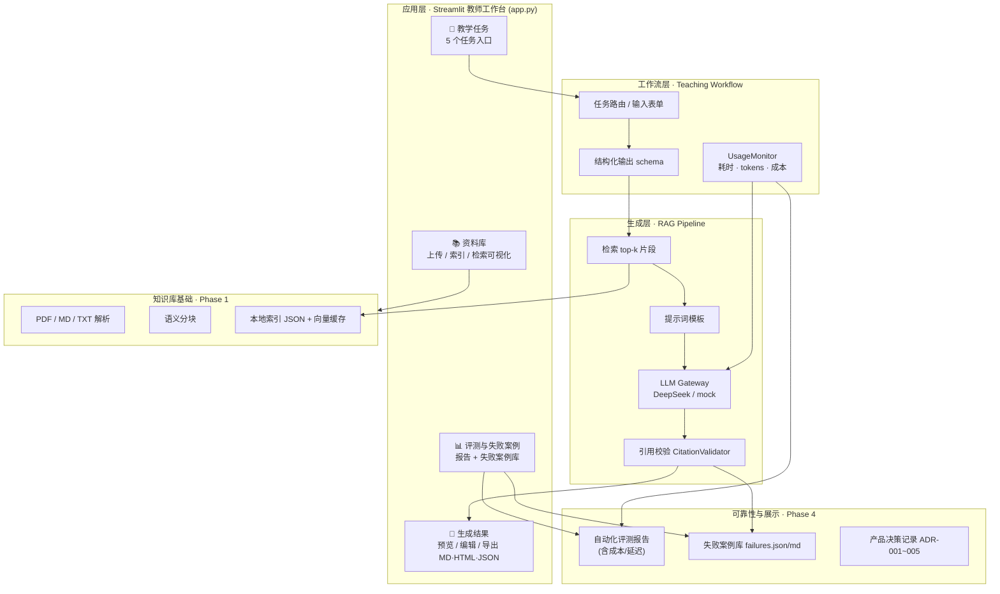

# 🏗️ 系统架构设计

## 整体架构

```
用户界面 (Streamlit UI)          ← Phase 4 教师工作台
        ↓
    任务选择
        ↓
   RAG 管道 (Phase 2)
    ↙       ↘
查询处理  LLM 生成
    ↓       ↓
 引用验证 ←←← 结果组装
        ↓
   用户看到的讲解
        
↑↑↑ 以上需要课程资料的"证据" ↑↑↑

知识库基础 (Phase 1)
    ↙   ↓   ↘
PDF解析 分块 检索
    ↓
本地索引 (JSON)
```

### Mermaid 架构图（Phase 4）



## 五层模块化架构

### 1️⃣ 数据模型层 (`src/core/models.py`)

**目的：** 确保数据完整性和可追踪性

**关键类：**
```python
Document(id, name, path, type, pages, metadata)
    ↓
Page(text, quality, section, page_num)
    ↓
Chunk(text, doc_id, page_num, char_start, char_end)
    ↓
SearchResult(chunk, score, rank, reasoning)
```

**特色：**
- ✅ 每个 Chunk 都有精确的源位置（文档 + 页码 + 字符位置）
- ✅ 页面质量评估（GOOD/PARTIAL/SCANNED/EMPTY/ERROR）
- ✅ 完整的类型提示，易于维护

**为什么这样设计：**
- RAG 生成需要精确的引用来源
- 无法引用 = 无法验证 = 无人敢用
- 页面质量标记帮助下游识别有问题的内容

---

### 2️⃣ 文档处理层 (`src/document/`)

#### PDF 解析器 (`pdf_parser.py`)

**输入：** PDF 文件路径  
**输出：** Document + List[Page]

```python
# 功能：
PDF 文件
    ↓
pdfplumber 提取文本
    ↓
逐页分析
    ├─ 是否有表格？→ has_tables
    ├─ 是否有图片？→ has_images
    └─ 是否有代码？→ has_code (正则匹配 ```、def、class)
    ↓
生成页面质量评估
    ├─ 页面为空？→ EMPTY
    ├─ 文本很少？(<50 字) → SCANNED
    ├─ 文本被截断？→ PARTIAL
    ├─ 提取出错？→ ERROR
    └─ 正常 → GOOD
    ↓
生成 document_id (MD5 哈希)
```

**特色：**
- ✅ 自动生成唯一 ID（MD5 哈希前 8 字符 + 文件名）
- ✅ 质量评估帮助识别问题文件
- ✅ 页面元数据保留

**关键决策：** 为什么用 MD5 哈希作为 ID？
- 同一文件多次上传会识别为重复 ✓
- 文件修改会生成新 ID ✓
- 不需要用户手工输入 ID ✓

---

#### 文本分块器 (`text_chunker.py`)

**输入：** List[Page]  
**输出：** List[Chunk]

```python
# 分块策略：
页面文本
    ↓
按句子分割 (。！？ 和 .!? 以及中英文混合)
    ↓
合并相邻句子，形成块
    ├─ 单个块 ≤ 1000 字（配置项）
    ├─ 句子重叠 2 个（确保上下文连贯）
    └─ 每块内追踪精确的字符位置
    ↓
为每块分配 ID
    └─ 格式：{prefix}_{page}_{counter}
    ↓
估算 token 数（字符数 / 1.5）
```

**特色：**
- ✅ 精确的字符位置（char_start, char_end）
- ✅ 中文和英文都能正确分割
- ✅ 句子重叠保证 LLM 看到完整上下文

**关键决策：** 为什么按句子而不是按段落分块？
- 段落可能很长（>5000 字）
- 句子是语义最小单位，便于理解
- 组合句子比分割句子更容易（重叠）

---

#### 文档加载器 (`document_loader.py`)

**输入：** 文件路径或目录  
**输出：** 本地 JSON 索引

```python
# 工作流程：
上传 PDF 文件
    ↓
检查是否已加载过 (通过 document_id)
    ├─ 是 → 跳过（避免重复）
    └─ 否 → 继续
    ↓
PDF 解析 → Document + Pages
    ↓
文本分块 → Chunks
    ↓
存储到内存：
    ├─ self.documents[doc_id] = Document
    └─ self.chunks = [all chunks]
    ↓
保存到磁盘：
    └─ data/index/COMP5310.json
```

**特色：**
- ✅ 自动检测和跳过重复文件
- ✅ 内存 + 磁盘双备份
- ✅ 支持批量导入整个目录

---

### 3️⃣ 检索层 (`src/retrieval/retriever.py`)

**输入：** 查询文本 + Chunks  
**输出：** List[SearchResult]

支持两种检索器，通过 `RetrieverFactory` 切换（默认 `embedding`）：

#### EmbeddingRetriever（默认 ✅）

```python
# Embedding 检索流程：
用户查询（中文/英文均可）
    ↓
用多语言模型编码查询 → 向量
    ├─ e5 模型加 "query: " 前缀
    └─ 归一化
    ↓
与 chunk 向量计算余弦相似度
    └─ 相似度 = 向量点积（已归一化）
    ↓
按相似度排序，返回 Top-K
    └─ 分数 = 余弦相似度（0~1）
```

**特色：**
- ✅ 跨语言：中文查询能匹配英文课件（"数据探索" → "Data Exploration"）
- ✅ 语义匹配：能关联近义词（"hotel" → "accommodation"）
- ✅ 向量缓存到磁盘（`data/index/*_embeddings.npy`），避免重复编码

**模型：** `intfloat/multilingual-e5-small`（多语言，~470MB，本地离线）

#### TFIDFRetriever（可切换）

精确关键词匹配，完全可解释，无额外依赖。适合调试和评测基线。

**关键决策：** TF-IDF vs Embedding

| 方面 | TF-IDF | Embedding |
|------|--------|-----------|
| 跨语言检索 | ❌ 中文查不到英文 | ✅ 支持 |
| 语义匹配 | ❌ 只认精确词 | ✅ 近义词/同义 |
| 速度 | < 10ms | 50-200ms（首次加载模型更久） |
| 可解释性 | 高 | 低 |
| 依赖 | 无（只需数学） | 需要 torch + 预训练模型 |

**演进过程：**
- 先用 TF-IDF 快速验证系统可行性（Phase 1 早期）
- 遇到跨语言、语义匹配瓶颈后，升级为 Embedding（默认）
- 通过 `RetrieverFactory` 保留 TF-IDF 作为可选/评测基线

---

### 4️⃣ RAG 管道 (`src/rag/` - Phase 2 ✅ 已实现)

**已实现组件：**
- `pipeline.py` - 编排完整流程
- `llm_client.py` - DeepSeek API 封装（OpenAI 兼容，支持 mock 模式）
- `citation_validator.py` - 验证引用准确性

**工作流程：**

```
用户查询
    ↓
检索相关内容
    ├─ 调用 Retriever.search()
    └─ 获取 Top-5 相关 Chunks
    ↓
组装上下文
    ├─ 合并多个 Chunks
    ├─ 保留页码信息
    └─ 格式化为提示词
    ↓
调用 LLM（DeepSeek）
    ├─ 系统提示词：你是讲师，只用这些资料
    ├─ 用户提示词：讲解递归算法
    ├─ 检索结果：[来自课程的相关内容]
    └─ 生成讲解
    ↓
验证和优化
    ├─ 检查生成的文本是否引用了来源
    ├─ 验证引用的 chunk_id 是否存在
    └─ 如有问题则重新生成
    ↓
添加引用
    ├─ 找出讲解中使用的 chunks
    ├─ 为每个 chunk 标注"参见第 X 页"
    └─ 输出结构化结果
```

**关键组件：**
1. `pipeline.py` - 编排整个流程
2. `llm_client.py` - DeepSeek API 封装
3. `citation_validator.py` - 验证引用准确性

---

### 5️⃣ 提示词模板 (`src/prompts/` - Phase 2 ✅ 已实现)

**已实现的 4 个任务模板**（`teaching_templates.py`）：

```python
# 1. 课程讲解
LESSON_TEMPLATE = """
你是资深大学讲师。根据以下课程资料，讲解"{topic}"：

【课程资料】
{context}

【讲解要求】
1. 核心定义（2-3 句）
2. 为什么重要（1-2 句）
3. 实例演示（至少 2 个例子）
4. 常见误区和澄清
5. 与先修知识的联系

【重要】
- 只使用上面的课程资料
- 不要编造例子或数据
- 每个论点都要引用来源
"""

# 2. 讲题解答
PROBLEM_SOLVING_TEMPLATE = """
你是讲师讲解这道题：
{problem_text}

【相关课程内容】
{context}

【解题步骤】
1. 理解题意
2. 找关键概念
3. 列出解法步骤
4. 逐步计算或推导
5. 验证答案
6. 总结要点

仅使用课程资料中的方法。
"""

# 3. 期末复习
REVIEW_TEMPLATE = """
根据课程资料，为 {chapter} 创建复习文档：

【资料】
{context}

【输出结构】
- 核心概念列表（5-10 项）
- 关键公式或定义
- 典型例题（2-3 个）
- 常见陷阱
- 与其他章节的联系
"""

# 4. 速查表
CHEATSHEET_TEMPLATE = """
创建关于 {topic} 的速查表：

【格式】
- 定义（一句话）
- 用途（何时使用）
- 例子（代码/公式）
- 常见变体
"""
```

---

## 配置系统 (`src/core/config.py`)

**设计理念：** 一处配置，全局生效

```python
Config
  ├─ DocumentConfig          # PDF 处理参数
  │   ├─ chunk_max_tokens: 1000
  │   ├─ chunk_overlap_sentences: 2
  │   └─ max_chars_per_page: 5000
  │
  ├─ RetrieverConfig         # 搜索参数
  │   ├─ retriever_type: "embedding"  # 可选 "tfidf", "bm25", "embedding"
  │   ├─ top_k: 5
  │   ├─ score_threshold: 0.0
  │   └─ embedding_model: "intfloat/multilingual-e5-small"
  │
  ├─ LLMConfig               # LLM 参数（Phase 2）
  │   ├─ provider: "deepseek"
  │   ├─ model: "deepseek-chat"
  │   ├─ temperature: 0.7
  │   └─ api_key: 从 .env 读取
  │
  └─ OutputConfig            # 输出参数
      ├─ output_format: "markdown"
      └─ include_citations: True
```

**用法：**
```python
from src.core.config import Config

config = Config()
config.document.chunk_max_tokens = 1500  # 改参数
loader = DocumentLoader(chunker=TextChunker(config.document))  # 传入配置
```

---

## 数据流向

### 完整的数据路径

```
用户上传 PDF
    ↓ (pdf_parser.py)
Document(id, pages, metadata)
    ↓ (text_chunker.py)
Chunk(text, doc_id, page_num, char_start, char_end)
    ↓ (document_loader.py)
保存到 self.chunks 列表 + data/index/COURSE.json
    ↓ (retriever.py - 初始化)
编码 chunk 为向量（embedding），缓存到 data/index/COURSE_embeddings.npy
    ↓ (retriever.py - 搜索)
用户查询 → SearchResult[score, chunk, rank]
    ↓ (rag/pipeline.py - Phase 2)
LLM 生成讲解
    ↓ (rag/citation_validator.py)
验证每句话的来源
    ↓
最终输出：讲解 + 页码引用
```

---

## 扩展点

### 1. 支持新的检索算法

```python
# 当前默认（多语言语义检索）
retriever = RetrieverFactory.create(
    "embedding", chunks, docs,
    model_name="intfloat/multilingual-e5-small",
    cache_path=str(Config.get_embedding_cache_path("COMP5310")),
)

# 可切换回 TF-IDF（精确关键词，可解释）
retriever = RetrieverFactory.create("tfidf", chunks, docs)

# 未来可加 BM25
retriever = RetrieverFactory.create("bm25", chunks, docs)
# 需要实现：class BM25Retriever(BaseRetriever): ...
```

### 2. 支持新的 LLM

```python
# 当前计划是 DeepSeek
client = DeepSeekClient(api_key=KEY)

# 未来可支持
client = OpenAIClient(api_key=KEY)
client = ClaudeClient(api_key=KEY)
client = LocalLlamaClient(model_path=PATH)
```

### 3. 支持更多文档类型

```python
# 当前支持 PDF
parser = PDFParser()

# 未来可支持
parser = DocxParser()      # Word 文档
parser = PowerPointParser() # PPT
parser = ImageParser()      # 扫描图片 + OCR
parser = WebParser()        # 网页快照
```

### 4. 性能优化

**缓存层（Redis）：**
- 同样查询第二次会更快
- 常见问题的答案可以预热

**向量数据库：**
- 大规模课程资料（>10,000 chunks）
- 需要高精度检索时升级

**异步处理：**
- 长文件转换、LLM 生成等可异步执行
- 用 Celery + Redis 实现任务队列

---

## 测试策略

```
单元测试 (test_models.py, test_chunking.py, test_rag.py)
    ↓
Phase 3 测试 (test_phase3.py)   # 讲题/复习/速查表/真题映射 + 评测
    ↓
集成测试 (test_end_to_end.py)
    ↓
演示脚本 (demo_phase1/2/3.py)
    ↓
真实数据验收 + 统一评测报告
    ↓
用户反馈 (老师评测)
```

---

## 性能指标（更新）

| 指标 | 目标 | 说明 |
|------|------|------|
| 引用页码准确率 | ≥ 90% | 由评测模块按任务统计 |
| 资料外无依据回答率 | < 5% | `out_of_scope_refusal_rate` |
| 关键结构化字段完整率 | ≥ 95% | `field_complete_rate` |
| 备课包可编辑时间 | 明显少于从零撰写 | 由老师实测 |

---

## 安全与隐私

| 方面 | 当前状态 | 未来改进 |
|------|--------|--------|
| 数据位置 | ✅ 本地文件 | 数据加密（可选） |
| API 密钥 | ✅ .env 文件 | 密钥管理系统 |
| 学生隐私 | ⚠️ 用户负责 | 自动脱敏工具 |
| 审计日志 | ❌ 无 | 完整的操作日志 |

---

**最后更新：** 2026-08-30  
**版本：** 1.1（基于 Phase 1 + Embedding 检索）  
**相关文档：** [目录结构](DIRECTORY_GUIDE.md) | [使用指南](README_CN.md)

---

## Phase 3：作业 / 真题 / 期末复习 + 统一评测 ✅

Phase 3 在 Phase 2 的单任务（备课包）基础上，扩展到三个高价值教学场景，并加入统一任务评测。

### 新增任务与结构化输出

| 任务 | 输出 dataclass | 关键字段 |
|------|----------------|---------|
| ✏️ 作业讲题 | `GeneratedProblemSolution` | problem_summary、knowledge_points、steps、layered_hints、rubric_mapping、reference_direction |
| 🎓 期末复习 | `GeneratedReview` | knowledge_map（依赖/支撑）、core_concepts、confusion_points、self_test_questions、exam_mapping、priority_advice |
| 📋 两页速查表 | `GeneratedCheatsheet` | sections（definition/formula/step/comparison/example）、layout_notes、compression_advice、within_page_limit |
| 🗺️ 真题映射 | `ExamKnowledgeMapping` | knowledge_points（含 evidence 依据）、coverage_gap |

每个 dataclass 都实现了 `to_dict()`（JSON 导出）和 `completeness()`（字段完整率评测）。

### 讲题模式的「教学辅导」边界

`PROBLEM_SOLVING_TEMPLATE` 明确要求：

- 分步解题思路（每步带提示，不直接给答案）
- **分层提示**（Level 1 → Level 3 逐步接近答案）
- 与评分标准的对应（rubric_mapping）
- 只给「参考解题方向」，不生成可直接提交的答案
- 与作业 PDF 的来源引用绑定

### Pipeline 新增方法（`src/rag/pipeline.py`）

```
generate_lesson()            # Phase 2：备课包
generate_problem_solution()  # Phase 3：作业/真题讲题
generate_review()            # Phase 3：期末复习包
generate_cheatsheet()        # Phase 3：两页速查表
generate_exam_mapping()      # Phase 3：真题知识点映射
generate_task()              # 统一分发入口（供评测模块调用）
save_result() / _render_markdown()  # 通用导出（md/json）
```

每个方法都遵循同一管道：检索 → 组装上下文（`format_context`）→ 构建消息 → LLM 生成 JSON → 解析 → **引用校验** → 填充 `needs_review`。

### 统一评测模块（`src/eval/evaluator.py`）

`TaskEvaluator` 把一组 `EvaluationCase` 跑过 pipeline，产出 `EvaluationReport`：

| 指标 | 说明 |
|------|------|
| 引用准确率 | 模型提出的 citations 中，真实存在且页码正确的比例（独立于管道重新校验） |
| 字段完整率 | `completeness()` 中已填充字段的比例 |
| 完全完整率 | 所有必填字段都填充的用例比例 |
| 资料外拒答率 | 对资料未覆盖的问题，系统正确「拒答」的比例 |
| 任务专项 | 分层提示是否分级、知识地图是否有依赖、速查表是否在篇幅内、真题映射是否有依据 |

`EvaluationCase` 支持 `out_of_scope=True`，用于测试「资料外问题」是否被拒答而不是编造。

### 评测数据流向

```
EvaluationCase[]（问题集：课件内概念 / 作业题 / 复习 / 速查表 / 真题 / 资料外问题）
    ↓ TaskEvaluator.evaluate(pipeline, cases)
每个 case → pipeline.generate_task()
    ↓ 指标计算（引用校验独立进行，不依赖管道过滤）
EvaluationReport（overall + by_task + 分用例）
    ↓ 导出
data/output/eval/phase3_evaluation_report.md / .json
```

---

## 测试策略（更新）

```
单元测试 (test_models.py, test_chunking.py, test_rag.py)
    ↓
Phase 3 测试 (test_phase3.py)   # 讲题/复习/速查表/真题映射 + 评测
    ↓
集成测试 (test_end_to_end.py)
    ↓
演示脚本 (demo_phase1/2/3.py)
    ↓
真实数据验收 + 统一评测报告
    ↓
用户反馈 (老师评测)
```

---

## 性能指标（更新）

| 指标 | 目标 | 说明 |
|------|------|------|
| 引用页码准确率 | ≥ 90% | 由评测模块按任务统计 |
| 资料外无依据回答率 | < 5% | `out_of_scope_refusal_rate` |
| 关键结构化字段完整率 | ≥ 95% | `field_complete_rate` |
| 备课包可编辑时间 | 明显少于从零撰写 | 由老师实测 |

---

## 6️⃣ 可靠性与展示层（Phase 4）

### 成本与延迟监控（`src/eval/monitor.py`）

- `UsageMonitor.record(...)` 记录每次 LLM 生成的耗时、估算 tokens 与成本；
- 成本按每 100 万 token 单价估算（`LLM_PRICE_INPUT_PER_M` / `LLM_PRICE_OUTPUT_PER_M` 可覆盖）；
- 追加写入 `logs/usage.jsonl`（不含任何密钥），并聚合进评测报告；
- `RAGPipeline` 接受可选 `monitor`，每个 `generate_*` 调用自动记录。

### 失败案例库（`src/eval/failure_library.py`）

- 产品规划 7.3 要求"必须保留失败案例"；
- `FailureLibrary` 将失败写入 `data/output/failures/failures.json` + `failures.md`；
- `examples/demo_phase4.py` 在评测运行后自动收集：管道异常、引用不准确、资料外未拒答、需人工确认的引用告警；
- 同时保留手工沉淀的历史失败案例（如第 59 页超范围引用、跨语言检索空结果）。

### 教师工作台（`app.py`，Streamlit）

- 对应产品规划第 5 节：资料库 / 教学任务入口 / 生成结果区 / 评测与失败案例；
- 生成结果支持 Markdown / HTML / JSON 导出，老师可直接编辑 Markdown 后导出；
- 未配置 API key 时进入 mock 模式，全流程可离线演示。

---

**最后更新：** 2026-08-30  
**版本：** 1.2（Phase 4 完成：UI + 评测 + 成本/延迟 + 失败案例库 + ADR）  
**相关文档：** [目录结构](DIRECTORY_GUIDE.md) | [使用指南](README_CN.md) | [产品决策记录](decisions/)
